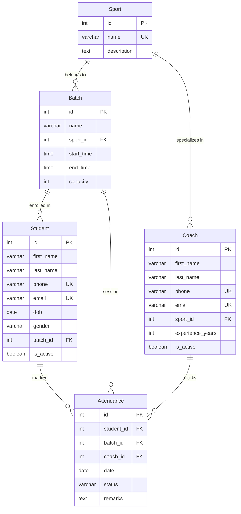

# Ace Sports Academy Management System ⚽🏸🎾

A professional, full-stack academy management portal designed to streamline sports programs, batch schedules, assistant coaches, student enrollments, and daily attendance logs. Built using a decoupled architecture with **Django REST Framework (DRF)** on the backend, a **MySQL** database, and **Flutter** for a premium Material 3 mobile application experience.

---

## 📱 Project Overview

Ace Sports Academy manages multiple training courses across various athletic fields. This application resolves the operational overhead of tracking student registration limits, scheduling conflicts, coaching assignments, and daily attendance marking by providing:
*   A centralized backend with relational schemas, transactional validations, and clean REST APIs.
*   An interactive, responsive Flutter UI with custom metrics widgets, drawer navigation, and search/filtering controls.

---

## 🛠️ Technology Stack

| Component | Technology | Description |
| :--- | :--- | :--- |
| **Backend Framework** | Django REST Framework (DRF) | Provides paginated, searchable REST CRUD APIs |
| **Database** | MySQL | Handles structured data storage and relational constraints |
| **Mobile App** | Flutter (Dart) | Material 3 client application supporting live API calls |
| **Network Layer** | Http (Dart) | Centralized asynchronous client communication |
| **Testing** | Django APITestCase | 50 unit and integration tests covering backend validation |

---

## ✨ Features Implemented

*   **Sports Catalog**: Register athletic courses (e.g. Football, Tennis) with format-validated descriptions.
*   **Batch Schedules**: Configure morning or evening training slots with duration checks and maximum capacities.
*   **Assistant Coaches**: Manage coaching directory, contact details, active status, and sports specialization.
*   **Student Directory**: Enroll student profiles, link them to specific batches, and manage active status.
*   **Attendance logs**: Mark students in a batch as Present (`P`), Absent (`A`), or Late (`L`) on a selected date.
*   **Dashboard View**: Consolidated statistics endpoint querying total students, coaches, batches, and today's attendance metrics in a single network trip.
*   **Query Search & Filters**: Built-in backend `SearchFilter` to query profiles by name, phone, email, or sport.
*   **Strict Validations**: Frontend checks backed by robust database-level constraints.

---

## 📁 Folder Structure

### Django Backend
```text
ace_sports_academy/
├── config/                  # Core settings, routing, and driver registry
│   ├── __init__.py          # PyMySQL driver configuration
│   ├── settings.py          # Database, Timezone, App Registry, and CORS
│   └── urls.py              # Global API routes namespace
├── apps/                    # Modular Django application modules
│   ├── sports/              # Sport model, ViewSets, and DashboardView
│   ├── batches/             # Batch model, serializers, and timing validation
│   ├── coaches/             # Coach schema, active status filters
│   ├── students/            # Student enrollments and capacity validation
│   └── attendance/          # Attendance logging, timezone localdate validations
├── manage.py                # Command-line admin helper
└── requirements.txt         # Python package requirements
```

### Flutter Frontend
```text
frontend/
├── lib/
│   ├── models/              # JSON serializers and model entities
│   │   ├── sport.dart
│   │   ├── batch.dart
│   │   ├── coach.dart
│   │   ├── student.dart
│   │   └── attendance.dart
│   ├── widgets/             # Reusable styling components (e.g. StatCard)
│   ├── screens/             # Interactive screens
│   │   ├── login_screen.dart
│   │   ├── dashboard_screen.dart
│   │   ├── sports_screen.dart
│   │   ├── batches_screen.dart
│   │   ├── coaches_screen.dart
│   │   ├── students_screen.dart
│   │   ├── student_profile_screen.dart
│   │   └── attendance_screen.dart
│   ├── services/            # Centralized API network service layer
│   │   └── api_service.dart
│   └── main.dart            # Theme configurations and route registry
```

---

## 🗄️ Database Design

We utilize a relational MySQL schema with foreign keys, cascaded deletions, and unique constraints.



---

## 🔄 API Architecture

The backend follows a strict decoupled flow to map database transactions to REST interfaces:

```text
Database (MySQL) ──> Model ──> Serializer ──> ViewSet ──> Router (URLs) ──> Client (JSON Response)
```

1.  **Model**: Defines schema structure, database-level rules, and ORM hooks (e.g. `self.full_clean()` on save).
2.  **Serializer**: Normalizes database entities, processes deep nested serializations (e.g., `batch_detail` and `sport_detail`), and validates input structures.
3.  **ViewSet**: Processes query parameters (for search/filtering), optimizes queries using `select_related` to avoid N+1 issues, and routes standard CRUD operations.
4.  **Router**: Automatically exposes standard REST URL path configurations.

---

## 📱 Flutter Architecture

The client-side app leverages clean UI separation:

*   **Models**: Cast flat JSON responses into typed Dart models for runtime safety.
*   **ApiService**: The centralized gateway utilizing `http` verbs to interact with the DRF server.
*   **Widgets**: Reusable, atomic design components (e.g., custom gradients, shadows, and status badges).
*   **Screens**: State management and validation controllers that render lists, process dialog forms, and navigate cleanly using `Hero` transitions and named routes.

---

## 🛡️ Validation Logic

Robust validation is enforced on both the client (for UX) and the backend (for data security):

| Validation Rule | Frontend (Flutter) | Backend (Django REST Framework / DB) |
| :--- | :--- | :--- |
| **Phone Number Format** | RegEx validation: `^\+?[1-9]\d{9,14}$` | `RegexValidator` on `phone` field. |
| **Email Validity** | Client email validator patterns | `EmailField` structure checks. |
| **Future DOB** | Dates of birth blocked beyond current date | Model `clean()` validation checks. |
| **Batch Timings** | Form validation: `start_time < end_time` | Serializer validation checks. |
| **Batch Capacity Limit** | Checks limit prior to posting | Exclude count queries during save transaction. |
| **Future Attendance** | Date picker limit (`lastDate: DateTime.now()`) | `timezone.localdate()` validation in serializers. |
| **Batch Enrollment Guard** | Filters student lists by current batch | Model validation enforcing student-batch mapping. |
| **Attendance Duplicate** | Check map states | Unique constraint: `student`, `batch`, `date`. |

---

## ⚠️ Challenges & Resolutions

1.  **Timezone Offsets (Future Attendance Error)**:
    *   *Challenge*: System clocks in local zones (e.g., India Time) crossing midnight would submit attendance dates that Django evaluated as "future dates" because the server was defaulting to UTC.
    *   *Resolution*: Configured `TIME_ZONE = 'Asia/Kolkata'` in settings and replaced UTC checks (`timezone.now().date()`) with local timezone evaluations (`timezone.localdate()`).
2.  **ALLOWED_HOSTS & CORS Settings**:
    *   *Challenge*: Testing the app on a physical device failed because Django blocked remote requests.
    *   *Resolution*: Allowed connection strings via setting `ALLOWED_HOSTS = ['*']` and configured `django-cors-headers` middleware.
3.  **N+1 Query Overhead**:
    *   *Challenge*: Nested details (like serializing a student's batch and a batch's sport) triggered multiple subsequent SQL queries.
    *   *Resolution*: Implemented `select_related('batch__sport')` in `StudentViewSet` to fetch all related tables in a single SQL JOIN transaction.

---

## 🛠️ Setup Instructions

### Backend Setup (Django)

1.  Navigate to the project root:
    ```bash
    cd ace_sports_academy
    ```
2.  Create and activate a virtual environment:
    ```bash
    python -m venv venv
    # Windows PowerShell
    .\venv\Scripts\Activate.ps1
    # macOS/Linux
    source venv/bin/activate
    ```
3.  Install dependencies:
    ```bash
    pip install -r requirements.txt
    ```
4.  Configure the database settings in `config/settings.py` with your local MySQL credentials.
5.  Execute migrations and start the server:
    ```bash
    .\venv\Scripts\python manage.py migrate
    .\venv\Scripts\python manage.py runserver 0.0.0.0:8000
    ```

### Frontend Setup (Flutter)

1.  Navigate to the frontend folder:
    ```bash
    cd frontend
    ```
2.  Install packages:
    ```bash
    flutter pub get
    ```
3.  Open `lib/services/api_service.dart` and configure `baseUrl` to match your local Django server's IP address:
    ```dart
    static const String baseUrl = 'http://127.0.0.1:8000/api';
    ```
4.  Run the application on an emulator or connected device:
    ```bash
    flutter run
    ```

---

## 📸 Screen Previews (Placeholders)

*   **Login Interface**: Enforces form fields validation.
*   **Dashboard View**: Consolidates statistics cards.
*   **Mark Attendance Sheet**: Standard selection controllers.
*   **Student Directory**: Custom profile details with Hero animations.

---

## 🚀 Future Improvements

*   **JWT Security**: Secure API endpoints using JSON Web Token authentication.
*   **RBAC (Role-Based Access Control)**: Restrict actions based on user roles (Admin vs Coach).
*   **Real-time Notifications**: Notify students of time changes or cancellations.
*   **Report Exporting**: Download monthly attendance sheets as PDF or Excel files.
# ace-sports-academy-management-system

